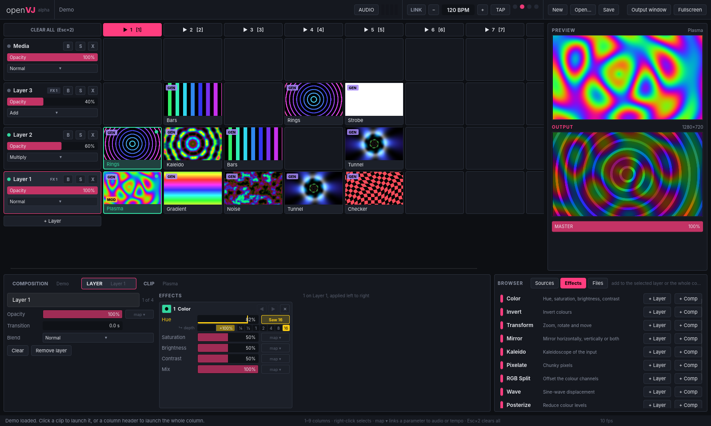

# openVJ

An open-source, layer-based VJ mixer: a clip grid, stacked layers with blend modes, live shader generators and video loops, all mixed on the GPU. Think Resolume, but open. Written in Rust with [wgpu](https://wgpu.rs) and [Slint](https://slint.dev).

> **Version 0.1.0**, the first release. It's young: expect rough edges, and file formats may still change before 1.0. See [what's new](CHANGELOG.md) and the [known limits](#known-limits).

## Download

**[Download openVJ for macOS](https://github.com/openwave-studio/openvj/releases/latest)** (Apple Silicon, macOS 11 or later): unzip it and drag **openVJ.app** to Applications. FFmpeg and Syphon are built in, so videos, cameras and Syphon work without installing anything else. The first time a camera clip plays or you turn on **AUDIO**, macOS asks for camera or microphone access.

Linux and Windows have no download yet: [build from source](#building-from-source).



## What works

- **Layouts**: the menu at the top left switches the whole window between **Mixer** (the full mixing screen, to perform by combining layers), **Player**, **Synthesis** and **Discover**, as in openDJ. **Cmd+1/2/3/4** (Ctrl on Linux and Windows) switch too, and openVJ reopens in the last one. Switching never interrupts the output.
- **Discover**: a layout for sorting new sources before a show, not for performing: nothing in it reaches the output. It plays the library's not-reviewed generators, effects and MilkDrop presets one at a time, live with audio, from the packs you pick (**FROM**), in random or pack order, with what's up next and how many are left. Adjust the parameters, or press **R** to randomize every one you haven't locked, with **Undo** and **Reset**. Set intensity (**0–5**), crates and tags, then **K** keeps it in My library, **S** keeps it and saves a new preset with these values, **→** skips it for another time and **X** moves it to Unwanted. Click an Up next tile to jump to it.
- **Player**: an automix player in the style of openDJ's Automix. A playlist holds presets: a generator with its parameter values, audio mappings, Transform and effects, so the same generator can appear several times with different looks. Use **Add to playlist** in a clip's Clip tab (or **+ Add** in the Player) to capture the selected clip. **AUTOMIX** plays each preset for its own time (4 to 64 bars, following BPM and Link, or 15 to 60 seconds), then brings in the next with **LENGTH** (0 to 8 seconds, or 1 to 4 bars) and **STYLE** (Crossfade, Cut, Fade through black), with Shuffle and Repeat. The Player plays on its own, apart from the composition; launching a clip or column in Mixer takes the output back. Playlists save as `.ovjplaylist` files, to prepare them before a show. Videos and images can't go in a playlist yet.
- **Synthesis**: a layout to perform one visual, laid out like a synth. Pick a layer on the left; its visual fills the screen, with the output beside it. Below are knobs (used only here), split like Synesthesia's controls. **SCENE CONTROLS** are the visual's own: **SOURCE** (the generator's parameters), one section per clip effect, and **OUTPUT** (master). **META CONTROLS** belong to the layer and stay when it plays another visual: **Master** (the layer's opacity), **Color** (invert, brightness, gamma, contrast, hue, saturation), **Mirror**, **Limit colors** (a low and a high colour) and **Alpha channel** (black turns transparent, for Syphon). Every section, and each row as a whole, has **lock**, **undo**, **default** and **random**; random skips locked sections. **MEDIA** puts an image, video or camera over the layer's visual with a blend mode and amount, play, previous, next and stop, a loop mode, a scrub bar and speed, a transform (scale, fit or fill, flips) and colour. Its browser shows the folders you add (**+ add folder**; double-click a folder's chip to take it off), live sources and thumbnails, with **lock** so a stray click can't change the overlay during a show. Each visual has 8 **macros**: press **Map** under a macro, click the knobs it should move, then **Done**. Turning the macro moves all of them at once, each from where it was toward the other end of its range. A macro takes a driver from its **map ▾** menu (audio levels, hits or a tempo shape), so it can animate several parameters together. Macros are saved with the clip, and go into playlists with it. Knobs turn by dragging up and down; double-click resets.
- **Decks**: tabs under the grid, like Resolume's. Each deck has its own columns and clips and shares the layers and effects. Switching decks doesn't stop what's playing. **+ Deck** adds one, double-click a tab to rename it, and × removes the open deck.
- **Clip grid**: rows are layers, columns are clip slots. Click a clip to launch it. Click a column header (or press **1–9**) to launch the whole column; layers with an empty slot in that column are cleared.
- **Layers**: opacity fader, 9 blend modes (Normal, Add, Screen, Multiply, Overlay, Difference, Lighten, Darken, Subtract), **B**ypass, **S**olo, clear (**X**), and a crossfade transition time per layer.
- **Layer groups**: put layers in a group from the Layer tab. A group mixes its layers on their own, then blends the result into the composition with its own opacity, blend mode, bypass, solo and effect chain (the **Group** tab). Grouped layers show a green edge and the group's name.
- **Crossfader**: assign a layer to side **A** or **B** in the Layer tab, then fade between the sides with the crossfader under the master fader (double-click recentres it). It can be mapped to audio or tempo like any parameter, and has a linear curve or one that keeps both sides full in the middle.
- **Clip playback**, like Resolume's clip transport: a play mode per clip (Loop, Bounce, Random, Play once & clear, Play once & hold), and either the clip's own speed or **beat sync**, where one pass through the clip lasts ¼ to 256 beats at the current tempo (and follows Ableton Link). Stills and generators get a duration for the modes that need an end. Videos seek and play backwards for Bounce and Random. **Autopilot** (as in Resolume) launches the next, previous, a random, the first or the last clip in the layer when a clip finishes a pass; beat-synced clips hand over exactly on the beat. **Trigger** sets how launching behaves: Normal, Toggle (launching the playing clip again clears the layer) or Piano (the clip plays while its MIDI note or the mouse button is held, at the note's velocity, and the layer clears when it's let go).
- **Sources**:
  - 9 built-in GPU **generators**: Plasma, Tunnel, Bars, Rings, Noise, Kaleido, Gradient, Strobe, Checker. Each has 4 parameters and a speed control. Bars, Rings and Strobe lock to the BPM.
  - 345 **ISF generators** from [Ghost Arcade](https://github.com/riskcapital/ghost-arcade)'s pack, bundled, plus any ISF generator (an `.fs` file without an `inputImage`) dropped into the effects folders. They play as clips with their own parameters, follow the clip's speed and beat sync, and react to the audio bands.
  - **Shadertoy shaders**: **Import from Shadertoy…** in the Sources tab takes a shader's link and saves it as an ISF file in `~/Documents/openVJ/Effects/Shadertoy`, with its title, author, link and licence in the header. Buffers A–D become feedback passes, music and microphone channels follow openVJ's audio input (Shadertoy's 512×2 spectrum and waveform texture), and a shader that filters a webcam or video channel is imported as an effect. Fetching by link uses the [Shadertoy.com API](https://www.shadertoy.com/howto) with your own key (Settings → Media), and only shaders their authors set to "Public + API" can be fetched; without a key, paste the Image tab's code instead. Clips and effects from Shadertoy have an **Open on Shadertoy** link. Texture channels download Shadertoy's images into a `textures` folder next to the shader, the keyboard reads as no keys pressed, and cubemap and 3D texture channels aren't supported yet and read black. Most Shadertoy shaders are CC BY-NC-SA 3.0 (no commercial use), so none are bundled.
  - **MilkDrop presets** (`.milk`), played by [lactea](https://github.com/M0Rf30/lactea), a pure-Rust MilkDrop engine on the same GPU pipeline. Drop presets (for example projectM's [cream of the crop](https://github.com/projectM-visualizer/presets-cream-of-the-crop) pack) into `~/Documents/openVJ/MilkDrop`; they show up in the library (Sources tab, MilkDrop kind) within a second. They react to the raw audio as they do in MilkDrop, follow the clip's speed, and have a **Sensitivity** parameter (0–200 %, scaled by Reactivity). A `.milk` file from the Files tab works too. No presets are bundled: community packs have no clear licence. Textures a preset samples are found by name in a `textures` folder inside the MilkDrop folder.
  - **Images**: png, jpg, gif, webp, bmp.
  - **Video**: mov, mp4, mkv, webm, avi and others, decoded by FFmpeg. Resolume **DXV** movies (normal and high quality, with or without alpha) skip FFmpeg: openVJ reads their frames straight from the file and the GPU samples them as compressed BC textures, so many layers of HD DXV play without CPU-side pixel decoding. **HAP**, HAP Alpha, HAP Q, HAP Q Alpha and HAP R take the same GPU path (Snappy-compressed and chunked frames included).
  - **Cameras**: webcams, capture cards and virtual cameras (OBS Virtual Camera, Camo). The best format up to the composition size at 24 fps or more is picked automatically. On macOS, openVJ.app asks for camera access the first time a camera clip plays (with `cargo run`, macOS asks for the terminal instead).
  - **Syphon** (macOS): frames from Synesthesia, TouchDesigner, VDMX, ISF Editor and any other Syphon server. Syphon.framework is built in, nothing to install.
  - **Layer Router**, like Resolume's: a clip that shows another layer, a group or the whole composition (pick it under **Input** in the Clip tab; it's first in the INPUTS row). Use it to run a layer through different effects on another layer, or for feedback: an input drawn after the router (a layer above it, or the composition) shows its previous frame, so a router on the composition, scaled a little and below full opacity, makes trails and tunnels. Routed frames stay on the GPU, and nothing extra is kept while no router plays.
- **Library**: the Sources and Effects tabs show every generator, ISF shader, MilkDrop preset and saved preset as a thumbnail grid (or a list, in three tile sizes), with search (start typing anywhere), kind, intensity and audio-reactive filters. Chips switch between **My library** (what you keep; on first launch the built-ins, the bundled effects and one generator per category), **Favorites**, **Recent**, your crates, **Discover** (everything not reviewed yet) and **Unwanted** (hidden, never deleted). Click an item to try it on the Preview only: the output doesn't change. **Drag** it onto a clip slot to place it there, or onto a layer for that layer's first empty slot; drag an effect onto a clip, a layer or an effect chain in the properties panel. Double-click or **Enter** puts it in the selected slot (an effect on the selected layer). Cameras, Syphon servers, the Layer Router and media files drag onto slots the same way. On a selected item, **0–5** sets its intensity, **F** favorites it, **K** keeps it and **X** marks it unwanted. Thumbnails render in the background while openVJ runs (paused when frames get slow) and are cached in `~/Library/Caches/openVJ/Thumbnails`; **Use Preview as thumbnail** replaces one with the current Preview frame. **Tab** (or **Expand**) opens the library over the clip grid with a sidebar (library, kind, crates, pack, category), bigger tiles and an info panel to set tags and crates, add to the Player's playlist or put it in a slot; dragging an item out of it uncovers the clip grid to drop on. **Tab** or **Esc** goes back. Your choices are saved in `library.json` in the settings folder. The Files tab browses media on disk, and the inputs row under Sources lists cameras and Syphon servers (**Refresh** rescans cameras).
- **Properties dock** with Composition, Layer and Clip tabs, laid out like Resolume: master and audio input on the composition, opacity, blend, transition, Transform and an effect chain on each layer, and source parameters, speed, Transform and an effect chain on the clip.
- **Effects**: 12 GPU effects (Color, Invert, Transform, Mirror, Kaleido, Pixelate, RGB Split, Wave, Posterize, Blur, Edges, Acuarela) stacked in chains on any clip, layer or group and on the whole composition. A clip's chain runs on that clip alone, before the layer's transition, and the preview shows it. Each card has bypass, reorder, remove and a dry/wet mix, and shows every parameter in its real unit (degrees, %, px, named choices). Add them from the browser's Effects tab (**+ Clip** adds to the selected clip). Every clip and layer also has a fixed **Transform** card first, like Resolume's: Position X/Y in pixels, Scale and Scale W/H, Rotation X/Y/Z (X and Y tilt it in perspective) and Anchor. Left at its defaults it costs nothing. Drop more ISF effects (`.fs` files) into `~/Documents/openVJ/Effects`, the openVJ version of Resolume's Extra Effects folder; openVJ also reads the standard ISF folders on macOS (`~/Library/Graphics/ISF` and `/Library/Graphics/ISF`, where VDMX and ISF Editor keep theirs). New and edited files show up within a second, even while they're in use, and a file that doesn't compile is listed dimmed in the Effects tab with its error. Effects are [ISF](https://isf.video) shader files (see [Writing effects](#writing-effects)), and can have several passes and feedback buffers: Acuarela (watercolour smoke, rebuilt from Resolume's Wire patch) feeds each frame back into the next.
- **Parameter mapping**: every normalised parameter (clip parameters, layer opacity, master, effect parameters and mix) has a **map ▾** button. Map it to an audio band (Bass, Low mid, High mid, Treble), the overall Level, audio hits (Bass hits, Low mid hits, High mid hits, Treble hits, Hits: a spike on each kick or snare that falls back fast) or to a tempo-synced shape (Sine, Saw, Ramp down, Triangle, Square, Pulse, Random or Smooth random, over ¼ to 64 beats), then set the depth (−100% to +100%). Tempo shapes also have a **phase** (start a quarter, half or three quarters into the cycle, so two parameters can move against each other), and on a clip's parameters and effects, **from launch** starts the cycle when the clip is launched instead of on the global beat. Random holds a new value each cycle; Smooth random glides to it. The bar shows the base value and a live marker for the modulated value. Mappings are saved with the composition.
- **Audio input**: turn on **AUDIO** to analyse the default (or a chosen) input device. A 2048-point FFT feeds four auto-gained band levels with adjustable release, shown in the toolbar and the Composition tab, plus Synesthesia-style hits, presence and audio clocks per band and a 256-bin spectrum for shaders. **Reactivity** in the Composition tab (0–200%, saved with the composition) scales everything that follows the audio at once, like Synesthesia's Reactivity: turn it down when a track gets busy.
- **Monitors**: a Preview of the selected clip and the Output mix, both with live thumbnails in the grid. A separate **output window** can go fullscreen on a projector (double-click it or press `F`; `Esc` exits). On macOS the mix is also published as a **Syphon** server named "openVJ", so MadMapper, OBS, Synesthesia and other Syphon apps can take it. Frames stay on the GPU, and nothing is sent while no app is receiving; Settings → Output turns it off.
- **Tempo**: BPM ± and **TAP** tempo, with a 4-beat indicator. **LINK** joins an Ableton Link session, so the beat, tempo-synced generators and mappings follow Ableton Live, DJ software and other Link apps; tempo changes made here are sent to the session. **CLOCK** follows MIDI clock instead, from the first MIDI input that sends it (a groovebox such as the Circuit Tracks, a drum machine or a DAW): the tempo is measured from the clock, Start puts the beat back on bar 1, and Stop holds the beat until Continue or Start. ± and TAP are off while it's on, LINK and CLOCK turn each other off, and if the clock goes quiet the tempo holds. openVJ remembers CLOCK for next time.
- **Save/Open** compositions as JSON. Media paths are stored as-is.
- **Import Resolume compositions**: **Open…** also reads Resolume Arena and Avenue `.avc` files. Each Resolume deck with clips becomes a deck tab, and the deck that was open when the file was saved opens first. It brings over clip media and names, camera and Syphon inputs (matched by device or server name, so a webcam on a different USB port is still found), clip playback (play mode, BPM sync and beats, duration), column names, layer names, opacity, blend mode, bypass and transition time, layer groups with their effects, crossfader sides and position, BPM, clip and layer Transforms, and clip, layer, group and composition effects openVJ has an equivalent for, with their bypass, mix and the settings that map (each ISF input can name the Resolume parameter it imports from). Anything without an equivalent (Wire patches other than Acuarela, text generators, NDI inputs, effect settings openVJ lacks) is skipped and listed in the status bar and on stderr. Resolume saves absolute paths, so media is looked up next to the `.avc` file, and **Find media** searches any folder you pick for the rest. The import opens as a new composition; saving writes openVJ JSON and never touches the `.avc`. Run `cargo run -p openvj-resolume --example avc_info -- set.avc` to see what a file would import as.
- **MIDI controllers**: openVJ listens to every MIDI input (toggle with **MIDI** in the toolbar) and picks up controllers plugged in while it runs. **MIDI learn**: press **Cmd+M** (Ctrl+M on Linux and Windows) or **MAP** in the toolbar, as in Resolume. Every mappable control gets a cyan outline and its note or CC: master, crossfader, TAP, column headers, clips, layer opacity, bypass, solo and clear, and the parameters, mix and bypass of composition and layer effects. Click one, then move a knob or press a pad. Moving another control re-maps it, and **Delete** removes the mapping. The bar under the toolbar sets a fader's min and max (min above max inverts it) and a mapping's behaviour (Fader, Toggle, Press or Hold). Esc or Cmd+M leaves map mode; nothing is triggered while it's on. Mappings can also come from Resolume MIDI shortcut presets: importing an `.avc` also loads the preset it was saved with (Resolume's *MidiShortcutPreset*, looked up next to the `.avc` and in `~/Documents/Resolume Arena/Shortcuts/MIDI/`), and **Import Resolume preset…** in the Composition tab loads any preset `.xml` into the current composition. Supported shortcuts: clip and column launch, next/previous clip and column, next/previous deck, clear layer and clear all, layer opacity, bypass, solo, select, blend-mode buttons and faders (including the *selected layer* ones), master, effect parameters, mix and bypass, tap, resync and tempo. Faders keep Resolume's min/max range, and buttons keep toggle, momentary or press behaviour. Each shortcut keeps the controller it was made for, so a preset mixing several controllers works, and while that controller is connected, the same note or CC from another one is ignored. Mappings are saved with the composition and carry over to **New**. The Composition tab shows the last message received, to check a controller is getting through. Run `cargo run -p openvj-resolume --example midi_info -- preset.xml [set.avc]` to see what a preset would map to. Exporting learned mappings as a Resolume preset and controller LED feedback are not done yet.
- **Output mapping**: **Mapping** in the top bar opens a window modelled on Resolume's Advanced Output. *Output transformation* corner-pins each slice: drag a corner, nudge it with the arrow keys (Shift for 10 px, Tab for the next point) or type its position. Each slice also has a warp grid for curved surfaces, as in Resolume: set its columns and rows (2 to 32), switch between Linear and Bezier points, and drag the small grid points. *Input selection* sets which part of the composition each slice shows. Add, rename, reorder, hide and remove slices and masks; drag a mask's points, add points, and choose whether it shows or hides its inside (Resolume's Invert). Brightness, contrast and red/green/blue can be set per screen and per slice, plus the screen's opacity (double-click a bar to reset it). While the mapping window is open, slice outlines and the point being edited show on the output window too, so you can line up on the wall (turn off with *Outlines on output*). A test card shows a grid in every slice for lining up. Each screen has its own output window: the screen list on the left adds, renames, turns off and removes screens, and a screen's *Output* menu sends it to a connected display, where its window goes fullscreen when the output is open (a screen whose display isn't connected opens as a normal window). Imported screens set to Resolume's "Display 2" go to the second display. Turn on *Soft edge* on slices whose inputs overlap (for two blended projectors) and they fade across the overlap as in Resolume Arena; the curve (Power, Luminance, Gamma, per-channel gamma) is on the screen panel and imports from Resolume presets. The mapping is saved on this computer, not in the composition, like Resolume's. Resolume Advanced Output presets and `AdvancedOutput.xml` import from the mapping window or Settings → Output, with their linear and bezier grid warps and bezier masks. Run `cargo run -p openvj-resolume --example output_info -- preset.xml` to see what a file imports as.

### Controls

| Input | Action |
|---|---|
| Click clip | Launch it (and select it) |
| Right-click clip or slot | Select without launching (shows it in Preview and Properties) |
| Click column header / `1`–`9` | Launch a column |
| `Del` / `Backspace` | Remove the selected clip |
| `Esc` | Cancel a picked browser item; press twice quickly to clear all layers |
| `Tab` | Open or close the expanded library |
| `0`–`5`, `F`, `K`, `X` | On a selected library item: intensity, favorite, keep, unwanted |
| Double-click a fader | Reset it to 100% |
| `Cmd`/`Ctrl` + `1`, `2`, `3`, `4` | Mixer, Player, Synthesis, Discover layout |
| `R`, `0`–`5`, `K`, `S`, `→`, `X` | In Discover: randomize, intensity, keep, save as preset, skip, unwanted |

### Known limits

- Clips play video only: the audio track of a video isn't played.
- No image sequences (folders of numbered frames) yet.
- Only DXV and HAP decode on the GPU. Everything else (H.264, HEVC, ProRes, NotchLC…) is decoded by FFmpeg on the CPU, so many layers of HD H.264 cost more than the same in DXV or HAP.
- MIDI: learned mappings can't be exported as a Resolume preset yet (Resolume keys each shortcut by a controller hash we can't reproduce), and there's no controller LED feedback. Clip parameters, clip effects and group controls can't be mapped yet.
- Resolume Wire patches (other than Acuarela), text generators and NDI inputs don't import.
- Bezier and linear grid warps from Resolume presets show but can't be edited yet.

## Building from source

```bash
# Rust (if you don't have it)
curl --proto '=https' --tlsv1.2 -sSf https://sh.rustup.rs | sh
# CMake builds the Ableton Link SDK, and FFmpeg plays video files
# (images and generators work without it)
brew install cmake ffmpeg

git clone https://github.com/openwave-studio/openvj
cd openvj
cargo run --release
```

Optional argument: `cargo run --release -- ~/Movies/Loops` opens the file browser in that folder, and `cargo run --release -- my-set.json` opens a saved composition (a Resolume `.avc` works too).

Linux works too (Vulkan). Install `libxkbcommon-dev`, `libfontconfig-dev`, `libasound2-dev` (audio input), `cmake` and `clang` (Ableton Link). Windows should work but is untested.

To build without Ableton Link (and without CMake): `cargo run --release --no-default-features --features camera,syphon`. The `camera` and `syphon` features can be left out the same way.

A camera or Syphon input connects when its clip is launched or selected, and disconnects a few seconds after it stops. If the camera is unplugged or the Syphon app quits, the clip shows why and reconnects on its own once it's back.

Environment variables:

| Variable | Effect |
|---|---|
| `OPENVJ_MEDIA_DIR` | Where the file browser starts (default `~/Movies` or `~/Videos`) |
| `OPENVJ_FFMPEG_DIR` | Folder containing `ffmpeg` and `ffprobe` to use instead of the app's own, `PATH` or `/opt/homebrew/bin` |
| `OPENVJ_SNAPSHOT=out.png` | Save a screenshot of the window after ~2 s and quit (for CI and bug reports) |
| `SLINT_WGPU_CPU=1` | Allow software GPUs (lavapipe/llvmpipe), e.g. in headless CI |

### As a Mac app

`scripts/bundle-macos.sh` builds `target/macos/openVJ.app` and a zip of it, signed ad hoc. Start it with `open target/macos/openVJ.app` or from Finder. The app asks for camera and microphone access in its own name, so use it rather than `cargo run` when you play cameras or audio input. Run `scripts/build-ffmpeg-macos.sh` first (once, ~10 minutes) to put FFmpeg inside the app; the downloadable builds always include it, so they play video without Homebrew.

The [macOS app workflow](.github/workflows/macos-app.yml) builds the same zip for every push to main (and on demand from Actions → macOS app → Run workflow). Download it from that run's Artifacts or from the draft "dev build" release. A `v*` tag attaches it to a draft release for that version. Once the Developer ID secrets are set ([packaging/macos/README.md](packaging/macos/README.md)), those builds are signed and notarized. Until then they're signed ad hoc, and the first time you open a downloaded copy macOS refuses: go to System Settings → Privacy & Security and click **Open Anyway**.

## Architecture

```
crates/
  openvj-core     Composition model: layers × columns of clips, triggering, crossfades,
                  solo/bypass, effect chains, the built-in ISF effects (effects/*.fs), parameter
                  modulation (audio bands, tempo shapes), a beat clock, tap tempo, JSON save/load,
                  and the output mapping model (screens, slices, masks, warps). No GPU or UI code; unit-tested.
  openvj-audio    Audio input (cpal) and analysis (rustfft): four smoothed, auto-gained bands with
                  hits, presence and audio clocks, and a log-spaced spectrum.
  openvj-media    Images (image crate), video via an `ffmpeg` child process piping RGBA,
                  DXV and HAP decoding to BC textures from a small QuickTime reader,
                  thumbnails, frame pacing that drops frames rather than drifting. Live
                  inputs: cameras (nokhwa + yuvutils-rs) and Syphon (syphon-core), each on
                  its own thread keeping only the newest frame.
  openvj-render   wgpu engine. Each frame is a list of fullscreen passes:
                  clip → clip Transform and effects → (crossfade) → layer Transform and effects → blend into the comp (ping-pong)
                  → composition effects → master → output.
                  Mixing and effects run in 16-bit float; output, preview and thumbnails are 8-bit.
                  WGSL generators and blend modes are in shaders.wgsl. Effects are ISF files
                  compiled with naga's GLSL front end (isf.rs).
  openvj-resolume Resolume .avc import (roxmltree): maps every deck onto a Composition
                  and reports what was dropped. Also relinks missing media by file name,
                  and reads Advanced Output presets into an OutputSetup.
  openvj-app      Slint UI (ui/*.slint) + app state + Ableton Link (rusty_link, optional
                  `link` feature). The UI and engine share one wgpu
                  device, so the output, preview and live thumbnails are shown with
                  zero copies.
```

Everything runs on the UI thread except decoding, media loading and audio capture. A 60 Hz timer advances the composition clock, feeds new video frames and renders. Clip time comes from that one clock, so speed changes, retriggers and crossfades stay frame-accurate.

### Writing effects

An effect is one `.fs` file in the [ISF](https://isf.video) format: a JSON header in a comment, then GLSL. To try one, save it in `~/Documents/openVJ/Effects` (the Effects tab's **Open folder** button opens it, and `OPENVJ_EFFECTS_DIR` adds another folder): it appears in the Effects tab, and every save recompiles it live, keeping its parameter values. A file needs an `inputImage` input to be an effect; files without one are ISF generators and play as clips. Its id is `OPENVJ.ID`, or the file name without `.fs`, and can't be a built-in effect's id. The built-in ones are in [crates/openvj-core/effects](crates/openvj-core/effects); to add one, put the file there and in the `BUILTIN` list in `effect.rs`.

```glsl
/*{
    "DESCRIPTION": "Shown under the name in the browser",
    "CATEGORIES": ["Color"],
    "OPENVJ": {"ID": "tint", "NAME": "Tint", "RESOLUME": ["Tint"]},
    "INPUTS": [
        {"NAME": "inputImage", "TYPE": "image"},
        {"NAME": "amount", "LABEL": "Amount", "TYPE": "float", "MIN": 0, "MAX": 100, "DEFAULT": 50, "UNIT": "%"},
        {"NAME": "color", "TYPE": "color", "DEFAULT": [1, 0, 0, 1]}
    ]
}*/
void main() {
    vec4 c = IMG_THIS_PIXEL(inputImage);
    gl_FragColor = vec4(mix(c.rgb, c.rgb * color.rgb, amount / 100.0), c.a);
}
```

Supported: `float`, `long` (a named choice), `bool`, `event` (a one-frame trigger), `color` and `point2D` inputs; `PASSES` with `TARGET`, `PERSISTENT` (feedback) and `WIDTH`/`HEIGHT` expressions such as `"$WIDTH/2"`; `IMPORTED` images (PNG, JPEG, paths relative to the `.fs` file); `TIME`, `TIMEDELTA`, `FRAMEINDEX`, `PASSINDEX`, `RENDERSIZE`, and openVJ's `BEAT` and `AUDIO` (the four bands). Ghost Arcade's audio names (`audioBass`, `audioMid`, `audioHigh`, `audioLevel`, `audioBeat`, `sampleFFT()`, `sampleWaveform()` and friends) and `renderSize` also work, mapped onto the four bands, spectrum, beat and tempo. So do [Synesthesia](https://synesthesia.live)'s names: `syn_Level`, `syn_BassLevel`, `syn_MidLevel`, `syn_MidHighLevel`, `syn_HighLevel`, the same with `Hits`, `Presence` and `Time` instead of `Level` (hits spike on transients, presence is high while a band is strong, the times are clocks that run faster while a band is loud), `syn_CurvedTime`, `syn_OnBeat`, `syn_ToggleOnBeat`, `syn_RandomOnBeat`, `syn_BeatTime`, `syn_BPM`, `syn_BPMConfidence`, `syn_BPMTwitcher`, `syn_BPMSin`/`2`/`4`/`8`, `syn_BPMTri`/`2`/`4`/`8`, `syn_Spectrum` (r raw, g with release, b smooth, a waveform), `_uv`, `_uvc`, `_xy` and `FRAMECOUNT`. Synesthesia's Mid, MidHigh and High are openVJ's Low mid, High mid and Treble. Synesthesia scene folders (`.synScene`) and its helper functions (`_rotate`, `_noise`…) aren't supported. openVJ's own header keys are `OPENVJ` (a stable `ID` saved in compositions, the display `NAME`, the Resolume effect types it replaces on import), and per input `UNIT` (shown after the value), `WRAP` (angles and hues wrap around when modulated) and `RESOLUME`, the Resolume parameter the input imports from: `"Strength"` when Resolume saves it in the input's own units, or `{"NAME": "Hue Rotate", "RANGE": [0, 1]}` to map Resolume's range onto `MIN`..`MAX`. Shadertoy code works as is too: a `mainImage` without a `main`, `iTime`, `iTimeDelta`, `iFrame`, `iFrameRate`, `iResolution`, `iDate`, `iMouse` (zero, as before a click), `iChannelTime`, `iChannelResolution` and `iSampleRate`, so a Shadertoy Image tab saved as a `.glsl` file in the effects folder plays as a generator (its `iChannel`s read black). Files with their own `#version 450` line and explicit bindings, like [Varda](https://github.com/im-knots/varda)'s, also work, because bindings are matched by name. Extra image inputs and custom vertex shaders (`.vs` files) aren't supported yet.

Early research (written when this was planned as an OBS plugin) is in [docs/research](docs/research).

## Roadmap

Rough order after 0.1:

1. **0.2**: MIDI learn with controller LED feedback, clip audio, image sequences.
2. **Parameter animation**: Resolume-style envelopes, ranges and dashboard dials (planned in [openspec/changes/add-parameter-animation](openspec/changes/add-parameter-animation)).
3. **Polish**: drag and drop between slots and from the Finder, clip/column context menus, undo for structural edits, editable grid warps.
4. **Effects and generators**: more effects (Bloom, Trails, Fish Eye, Bendoscope, Cube Tiles, Colorize, ChromaKey) and hand-written generators (Waveform, Line Scape, Metaballs, text).
5. **Performance**: launch quantisation (beat/bar), OSC (`rosc`), hardware decode for H.264/HEVC/ProRes.
6. **Outputs**: per-layer and per-screen Syphon outputs, Spout (Windows), multiple outputs.

## Licence and credits

openVJ is GPL-3.0-or-later. See [LICENSE](LICENSE). Slint is used under its GPLv3 licence. [THIRD_PARTY_NOTICES.md](THIRD_PARTY_NOTICES.md) lists everything bundled and its licence; the Mac app carries the same notices in `Contents/Resources/ThirdParty`, and Settings → About shows them.

- **Ghost Arcade**: the bundled shaders in [shaders/ghost-arcade](shaders/ghost-arcade) come from [Ghost Arcade](https://github.com/riskcapital/ghost-arcade) by Risk Capital Media LLC and contributors, under the AGPL-3.0 (its LICENSE and a NOTICE listing every file are in that folder). They are loaded at runtime as data files. `scripts/import-ghost-arcade.py` re-imports them and leaves out files derived from Shadertoy and other non-commercial sources.
- **FFmpeg**: the Mac app includes a decode-only build of [FFmpeg](https://ffmpeg.org) under the LGPL-2.1-or-later, with libvpx (BSD), built by [scripts/build-ffmpeg-macos.sh](scripts/build-ffmpeg-macos.sh). openVJ runs it as a separate program.
- **Syphon**: [Syphon.framework](https://syphon.github.io) by Tom Butterworth and Anton Marini, under its BSD licence.
- **Varda**: [Varda](https://github.com/im-knots/varda) (MIT) is the reference for the projection mapping and camera input.
- **Fonts**: Inter (as Inter Tabular) and Zen Dots, under the SIL Open Font License.
