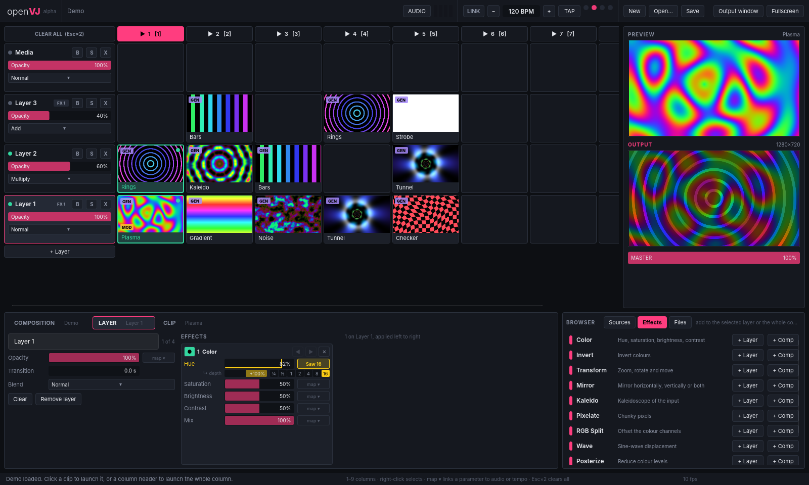

# openVJ

An open-source, layer-based VJ mixer: a clip grid, stacked layers with blend modes, live shader generators and video loops, all mixed on the GPU. Think Resolume, but open. Written in Rust with [wgpu](https://wgpu.rs) and [Slint](https://slint.dev).

> **Status: early alpha (0.1.0-alpha.1).** The UI, clip triggering, sources, GPU mixing, effect chains, audio-reactive parameters and Ableton Link work, and MIDI controllers can be mapped by importing a Resolume MIDI preset. Expect breaking changes.



## What works

- **Decks**: tabs under the grid, like Resolume's. Each deck has its own columns and clips and shares the layers and effects. Switching decks doesn't stop what's playing. **+ Deck** adds one, double-click a tab to rename it, and × removes the open deck.
- **Clip grid**: rows are layers, columns are clip slots. Click a clip to launch it. Click a column header (or press **1–9**) to launch the whole column; layers with an empty slot in that column are cleared.
- **Layers**: opacity fader, 9 blend modes (Normal, Add, Screen, Multiply, Overlay, Difference, Lighten, Darken, Subtract), **B**ypass, **S**olo, clear (**X**), and a crossfade transition time per layer.
- **Layer groups**: put layers in a group from the Layer tab. A group mixes its layers on their own, then blends the result into the composition with its own opacity, blend mode, bypass, solo and effect chain (the **Group** tab). Grouped layers show a green edge and the group's name.
- **Crossfader**: assign a layer to side **A** or **B** in the Layer tab, then fade between the sides with the crossfader under the master fader (double-click recentres it). It can be mapped to audio or tempo like any parameter, and has a linear curve or one that keeps both sides full in the middle.
- **Clip playback**, like Resolume's clip transport: a play mode per clip (Loop, Bounce, Random, Play once & clear, Play once & hold), and either the clip's own speed or **beat sync**, where one pass through the clip lasts ¼ to 256 beats at the current tempo (and follows Ableton Link). Stills and generators get a duration for the modes that need an end. Videos seek and play backwards for Bounce and Random.
- **Sources**:
  - 9 built-in GPU **generators**: Plasma, Tunnel, Bars, Rings, Noise, Kaleido, Gradient, Strobe, Checker. Each has 4 parameters and a speed control. Bars, Rings and Strobe lock to the BPM.
  - 345 **ISF generators** from [Ghost Arcade](https://github.com/riskcapital/ghost-arcade)'s pack, bundled, plus any ISF generator (an `.fs` file without an `inputImage`) dropped into the effects folders. They play as clips with their own parameters, follow the clip's speed and beat sync, and react to the audio bands.
  - **Images**: png, jpg, gif, webp, bmp.
  - **Video**: mov, mp4, mkv, webm, avi and others, decoded by FFmpeg. Resolume **DXV** movies (normal and high quality, with or without alpha) skip FFmpeg: openVJ reads their frames straight from the file and the GPU samples them as compressed BC textures, so many layers of HD DXV play without CPU-side pixel decoding. **HAP**, HAP Alpha, HAP Q, HAP Q Alpha and HAP R take the same GPU path (Snappy-compressed and chunked frames included).
  - **Cameras**: webcams, capture cards and virtual cameras (OBS Virtual Camera, Camo). The best format up to the composition size at 24 fps or more is picked automatically. On macOS, OpenVJ.app asks for camera access the first time a camera clip plays (with `cargo run`, macOS asks for the terminal instead).
  - **Syphon** (macOS): frames from Synesthesia, TouchDesigner, VDMX, ISF Editor and any other Syphon server. Syphon.framework is built in, nothing to install.
- **Browser**: a Sources tab (generators, plus the cameras and Syphon servers available right now; **Refresh** rescans cameras, Syphon servers appear on their own) and a Files tab. Click an item to pick it, then click a grid slot to place it. Double-click places it into the selected slot.
- **Properties dock** with Composition, Layer and Clip tabs, laid out like Resolume: master and audio input on the composition, opacity, blend, transition, Transform and an effect chain on each layer, and source parameters, speed, Transform and an effect chain on the clip.
- **Effects**: 12 GPU effects (Color, Invert, Transform, Mirror, Kaleido, Pixelate, RGB Split, Wave, Posterize, Blur, Edges, Acuarela) stacked in chains on any clip, layer or group and on the whole composition. A clip's chain runs on that clip alone, before the layer's transition, and the preview shows it. Each card has bypass, reorder, remove and a dry/wet mix, and shows every parameter in its real unit (degrees, %, px, named choices). Add them from the browser's Effects tab (**+ Clip** adds to the selected clip). Every clip and layer also has a fixed **Transform** card first, like Resolume's: Position X/Y in pixels, Scale and Scale W/H, Rotation X/Y/Z (X and Y tilt it in perspective) and Anchor. Left at its defaults it costs nothing. Drop more ISF effects (`.fs` files) into `~/Documents/openVJ/Effects`, the openVJ version of Resolume's Extra Effects folder; openVJ also reads the standard ISF folders on macOS (`~/Library/Graphics/ISF` and `/Library/Graphics/ISF`, where VDMX and ISF Editor keep theirs). New and edited files show up within a second, even while they're in use, and a file that doesn't compile is listed dimmed in the Effects tab with its error. Effects are [ISF](https://isf.video) shader files (see [Writing effects](#writing-effects)), and can have several passes and feedback buffers: Acuarela (watercolour smoke, rebuilt from Resolume's Wire patch) feeds each frame back into the next.
- **Parameter mapping**: every normalised parameter (clip parameters, layer opacity, master, effect parameters and mix) has a **map ▾** button. Map it to an audio band (Bass, Low mid, High mid, Treble) or to a tempo-synced shape (Sine, Saw, Square, Pulse over ¼ to 16 beats), then set the depth (−100% to +100%). The bar shows the base value and a live marker for the modulated value. Mappings are saved with the composition.
- **Audio input**: turn on **AUDIO** to analyse the default (or a chosen) input device. A 2048-point FFT feeds four auto-gained band levels with adjustable gain and release, shown in the toolbar and the Composition tab.
- **Monitors**: a Preview of the selected clip and the Output mix, both with live thumbnails in the grid. A separate **output window** can go fullscreen on a projector (double-click it or press `F`; `Esc` exits). On macOS the mix is also published as a **Syphon** server named "OpenVJ", so MadMapper, OBS, Synesthesia and other Syphon apps can take it. Frames stay on the GPU, and nothing is sent while no app is receiving; Settings → Output turns it off.
- **Tempo**: BPM ± and **TAP** tempo, with a 4-beat indicator. **LINK** joins an Ableton Link session, so the beat, tempo-synced generators and mappings follow Ableton Live, DJ software and other Link apps; tempo changes made here are sent to the session.
- **Save/Open** compositions as JSON. Media paths are stored as-is.
- **Import Resolume compositions**: **Open…** also reads Resolume Arena and Avenue `.avc` files. Each Resolume deck with clips becomes a deck tab, and the deck that was open when the file was saved opens first. It brings over clip media and names, camera and Syphon inputs (matched by device or server name, so a webcam on a different USB port is still found), clip playback (play mode, BPM sync and beats, duration), column names, layer names, opacity, blend mode, bypass and transition time, layer groups with their effects, crossfader sides and position, BPM, clip and layer Transforms, and clip, layer, group and composition effects openVJ has an equivalent for, with their bypass, mix and the settings that map (each ISF input can name the Resolume parameter it imports from). Anything without an equivalent (Wire patches other than Acuarela, text generators, NDI inputs, effect settings openVJ lacks) is skipped and listed in the status bar and on stderr. Resolume saves absolute paths, so media is looked up next to the `.avc` file, and **Find media** searches any folder you pick for the rest. The import opens as a new composition; saving writes openVJ JSON and never touches the `.avc`. Run `cargo run -p openvj-resolume --example avc_info -- set.avc` to see what a file would import as.
- **MIDI controllers**: openVJ listens to every MIDI input (toggle with **MIDI** in the toolbar) and picks up controllers plugged in while it runs. Mappings come from Resolume MIDI shortcut presets: importing an `.avc` also loads the preset it was saved with (Resolume's *MidiShortcutPreset*, looked up next to the `.avc` and in `~/Documents/Resolume Arena/Shortcuts/MIDI/`), and **Import Resolume preset…** in the Composition tab loads any preset `.xml` into the current composition. Supported shortcuts: clip and column launch, next/previous clip and column, next/previous deck, clear layer and clear all, layer opacity, bypass, solo, select, blend-mode buttons and faders (including the *selected layer* ones), master, effect parameters, mix and bypass, tap, resync and tempo. Faders keep Resolume's min/max range, and buttons keep toggle, momentary or press behaviour. Each shortcut keeps the controller it was made for, so a preset mixing several controllers works, and while that controller is connected, the same note or CC from another one is ignored. Mappings are saved with the composition and carry over to **New**. The Composition tab shows the last message received, to check a controller is getting through. Run `cargo run -p openvj-resolume --example midi_info -- preset.xml [set.avc]` to see what a preset would map to. MIDI learn and controller LED feedback are not done yet.
- **Output mapping**: **Mapping** in the top bar opens a window modelled on Resolume's Advanced Output. *Output transformation* corner-pins each slice: drag a corner, nudge it with the arrow keys (Shift for 10 px, Tab for the next corner) or type its position. *Input selection* sets which part of the composition each slice shows. Add, rename, reorder, hide and remove slices and masks; drag a mask's points, add points, and choose whether it shows or hides its inside (Resolume's Invert). A test card shows a grid in every slice for lining up. The output window shows the mapped screen. The mapping is saved on this computer, not in the composition, like Resolume's. Resolume Advanced Output presets and `AdvancedOutput.xml` import from the mapping window or Settings → Output, with their linear and bezier grid warps and bezier masks (those warps aren't editable yet). Run `cargo run -p openvj-resolume --example output_info -- preset.xml` to see what a file imports as.

### Controls

| Input | Action |
|---|---|
| Click clip | Launch it (and select it) |
| Right-click clip or slot | Select without launching (shows it in Preview and Properties) |
| Click column header / `1`–`9` | Launch a column |
| `Del` / `Backspace` | Remove the selected clip |
| `Esc` | Cancel a picked browser item; press twice quickly to clear all layers |
| Double-click a fader | Reset it to 100% |

## Running it (macOS, Apple Silicon)

```bash
# Rust (if you don't have it)
curl --proto '=https' --tlsv1.2 -sSf https://sh.rustup.rs | sh
# FFmpeg for video files (images and generators work without it)
brew install ffmpeg
# CMake builds the Ableton Link SDK
brew install cmake

git clone https://github.com/openwave-studio/openvj
cd openvj
cargo run --release
```

Optional argument: `cargo run --release -- ~/Movies/Loops` opens the file browser in that folder, and `cargo run --release -- my-set.json` opens a saved composition (a Resolume `.avc` works too).

Linux works too (Vulkan). Install `libxkbcommon-dev`, `libfontconfig-dev`, `libasound2-dev` (audio input), `cmake` and `clang` (Ableton Link). Windows should work but is untested.

To build without Ableton Link (and without CMake): `cargo run --release --no-default-features --features camera,syphon`. The `camera` and `syphon` features can be left out the same way.

A camera or Syphon input connects when its clip is launched or selected, and disconnects a few seconds after it stops. If the camera is unplugged or the Syphon app quits, the clip shows why and reconnects on its own once it's back.

Environment variables:

| Variable | Effect |
|---|---|
| `OPENVJ_MEDIA_DIR` | Where the file browser starts (default `~/Movies` or `~/Videos`) |
| `OPENVJ_FFMPEG_DIR` | Folder containing `ffmpeg` and `ffprobe` to use instead of the app's own, `PATH` or `/opt/homebrew/bin` |
| `OPENVJ_SNAPSHOT=out.png` | Save a screenshot of the window after ~2 s and quit (for CI and bug reports) |
| `SLINT_WGPU_CPU=1` | Allow software GPUs (lavapipe/llvmpipe), e.g. in headless CI |

### As a Mac app

`scripts/bundle-macos.sh` builds `target/macos/OpenVJ.app` and a zip of it, signed ad hoc. Start it with `open target/macos/OpenVJ.app` or from Finder. The app asks for camera and microphone access in its own name, so use it rather than `cargo run` when you play cameras or audio input. Run `scripts/build-ffmpeg-macos.sh` first (once, ~10 minutes) to put FFmpeg inside the app; the downloadable builds always include it, so they play video without Homebrew.

The [macOS app workflow](.github/workflows/macos-app.yml) builds the same zip: Actions → macOS app → Run workflow puts it on a draft "dev build" release, and a `v*` tag attaches it to a draft release for that version. Once the Developer ID secrets are set ([packaging/macos/README.md](packaging/macos/README.md)), those builds are signed and notarized. Until then they're signed ad hoc, and the first time you open a downloaded copy macOS refuses: go to System Settings → Privacy & Security and click **Open Anyway**.

## Architecture

```
crates/
  openvj-core     Composition model: layers × columns of clips, triggering, crossfades,
                  solo/bypass, effect chains, the built-in ISF effects (effects/*.fs), parameter
                  modulation (audio bands, tempo shapes), a beat clock, tap tempo, JSON save/load,
                  and the output mapping model (screens, slices, masks, warps). No GPU or UI code; unit-tested.
  openvj-audio    Audio input (cpal) and analysis (rustfft): four smoothed, auto-gained bands.
  openvj-media    Images (image crate), video via an `ffmpeg` child process piping RGBA,
                  DXV and HAP decoding to BC textures from a small QuickTime reader,
                  thumbnails, frame pacing that drops frames rather than drifting. Live
                  inputs: cameras (nokhwa + yuvutils-rs) and Syphon (syphon-core), each on
                  its own thread keeping only the newest frame.
  openvj-render   wgpu engine. Each frame is a list of fullscreen passes:
                  clip → clip Transform and effects → (crossfade) → layer Transform and effects → blend into the comp (ping-pong)
                  → composition effects → master → output.
                  Mixing and effects run in 16-bit float; output, preview and thumbnails are 8-bit.
                  WGSL generators and blend modes are in shaders.wgsl. Effects are ISF files
                  compiled with naga's GLSL front end (isf.rs).
  openvj-resolume Resolume .avc import (roxmltree): maps every deck onto a Composition
                  and reports what was dropped. Also relinks missing media by file name,
                  and reads Advanced Output presets into an OutputSetup.
  openvj-app      Slint UI (ui/*.slint) + app state + Ableton Link (rusty_link, optional
                  `link` feature). The UI and engine share one wgpu
                  device, so the output, preview and live thumbnails are shown with
                  zero copies.
```

Everything runs on the UI thread except decoding, media loading and audio capture. A 60 Hz timer advances the composition clock, feeds new video frames and renders. Clip time comes from that one clock, so speed changes, retriggers and crossfades stay frame-accurate.

### Writing effects

An effect is one `.fs` file in the [ISF](https://isf.video) format: a JSON header in a comment, then GLSL. To try one, save it in `~/Documents/openVJ/Effects` (the Effects tab's **Open folder** button opens it, and `OPENVJ_EFFECTS_DIR` adds another folder): it appears in the Effects tab, and every save recompiles it live, keeping its parameter values. A file needs an `inputImage` input to be an effect; files without one are ISF generators and play as clips. Its id is `OPENVJ.ID`, or the file name without `.fs`, and can't be a built-in effect's id. The built-in ones are in [crates/openvj-core/effects](crates/openvj-core/effects); to add one, put the file there and in the `BUILTIN` list in `effect.rs`.

```glsl
/*{
    "DESCRIPTION": "Shown under the name in the browser",
    "CATEGORIES": ["Color"],
    "OPENVJ": {"ID": "tint", "NAME": "Tint", "RESOLUME": ["Tint"]},
    "INPUTS": [
        {"NAME": "inputImage", "TYPE": "image"},
        {"NAME": "amount", "LABEL": "Amount", "TYPE": "float", "MIN": 0, "MAX": 100, "DEFAULT": 50, "UNIT": "%"},
        {"NAME": "color", "TYPE": "color", "DEFAULT": [1, 0, 0, 1]}
    ]
}*/
void main() {
    vec4 c = IMG_THIS_PIXEL(inputImage);
    gl_FragColor = vec4(mix(c.rgb, c.rgb * color.rgb, amount / 100.0), c.a);
}
```

Supported: `float`, `long` (a named choice), `bool`, `event` (a one-frame trigger), `color` and `point2D` inputs; `PASSES` with `TARGET`, `PERSISTENT` (feedback) and `WIDTH`/`HEIGHT` expressions such as `"$WIDTH/2"`; `TIME`, `TIMEDELTA`, `FRAMEINDEX`, `PASSINDEX`, `RENDERSIZE`, and openVJ's `BEAT` and `AUDIO` (the four bands). Ghost Arcade's audio names (`audioBass`, `audioMid`, `audioHigh`, `audioLevel`, `audioBeat`, `sampleFFT()` and friends) and `renderSize` also work, mapped onto the four bands, beat and tempo. openVJ's own header keys are `OPENVJ` (a stable `ID` saved in compositions, the display `NAME`, the Resolume effect types it replaces on import), and per input `UNIT` (shown after the value), `WRAP` (angles and hues wrap around when modulated) and `RESOLUME`, the Resolume parameter the input imports from: `"Strength"` when Resolume saves it in the input's own units, or `{"NAME": "Hue Rotate", "RANGE": [0, 1]}` to map Resolume's range onto `MIN`..`MAX`. Files with their own `#version 450` line and explicit bindings, like [Varda](https://github.com/im-knots/varda)'s, also work, because bindings are matched by name. Extra image inputs and custom vertex shaders (`.vs` files) aren't supported yet.

Early research (written when this was planned as an OBS plugin) is in [docs/research](docs/research).

## Roadmap

Rough order:

1. **Alpha polish**: drag and drop between slots and from the Finder, clip/column context menus, undo for structural edits, relink missing media.
2. **Effects**: more effects (Bloom, Trails, Fish Eye, Bendoscope, Cube Tiles, Colorize, ChromaKey).
3. **Performance**: launch quantisation (beat/bar), MIDI learn (`midir`) with controller LED feedback, OSC (`rosc`).
4. **Codecs**: hardware decode for H.264/HEVC/ProRes.
5. **Audio**: onset/beat detection, LFOs with free-running rates, per-mapping smoothing.
6. **Outputs**: per-layer and per-screen Syphon outputs, Spout (Windows), multiple outputs, slices and warping.

## Licence

GPL-3.0-or-later. See [LICENSE](LICENSE). Slint is used under its GPLv3 licence.

The bundled shaders in [shaders/ghost-arcade](shaders/ghost-arcade) come from [Ghost Arcade](https://github.com/riskcapital/ghost-arcade) by Risk Capital Media LLC and contributors, under the AGPL-3.0 (its LICENSE and a NOTICE listing every file are in that folder). They are loaded at runtime as data files. `scripts/import-ghost-arcade.py` re-imports them and leaves out files derived from Shadertoy and other non-commercial sources.
